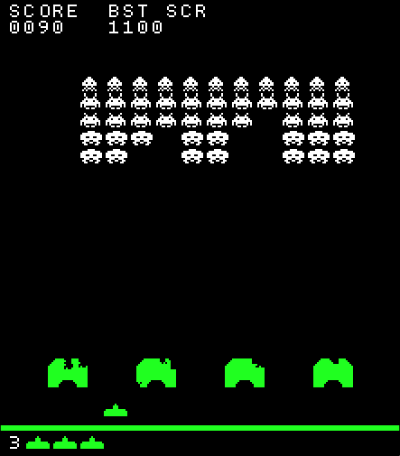

# Space Invaders

A simple game copy of Space Invaders written in C using the SDL library

## How to play

Use `left arrow key/A` and `right arrow key/D` to  move left and right. `space` to shoot or navigate the menu

In the menu you can use `up arrow key/W` and `down arrow key/S` to navigate the game options and `left arrow key/A` and `right arrow key/D` to change the selected option

## How to build

To prepare the project run:

> `cmake -S .`

To compile the project run:

> `cmake --build build`

### How to run

To run the project run:

> `./space-invaders`

inside the `build/` folder

## Modifying game logic

To modify most parameters used in-game you can edit the `config.h` inside the `source/` folder. Doing so might make the game a bit buggy